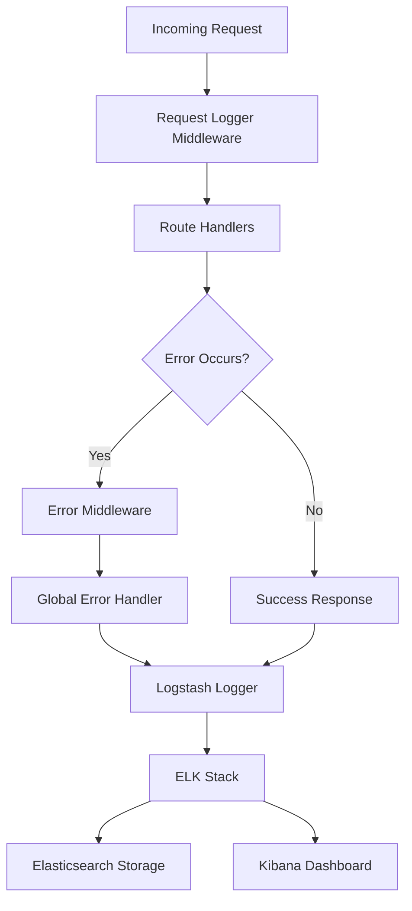

# Server Error Handling, Logging & Monitoring Documentation

> [!NOTE]
> This comprehensive guide documents the production-ready error handling, logging, and monitoring infrastructure implemented in the Onchain Intern Certificate server.

## Table of Contents

1. [Architecture Overview](#architecture-overview)
2. [Error Handling System](#error-handling-system)
3. [Custom Error Classes](#custom-error-classes)
4. [Error Middleware](#error-middleware)
5. [Logging System](#logging-system)
6. [Logstash Integration](#logstash-integration)
7. [Request Logging & Monitoring](#request-logging--monitoring)
8. [Best Practices & Usage Examples](#best-practices--usage-examples)
9. [Troubleshooting](#troubleshooting)

---

## Architecture Overview

The server implements a multi-layered error handling and logging architecture:



### Key Components

| Component | File | Purpose |
|-----------|------|---------|
| **Base Error Class** | [`AppError.ts`](file:///c:/Users/samee/Desktop/Finn/Coding/Onchain-Intern-Certificate-development/workflow%20branch/server/src/utils/AppError.ts) | Foundation for all custom errors |
| **Custom Errors** | [`CustomErrors.ts`](file:///c:/Users/samee/Desktop/Finn/Coding/Onchain-Intern-Certificate-development/workflow%20branch/server/src/utils/errors/CustomErrors.ts) | Domain-specific error classes |
| **Error Middleware** | [`error.middleware.ts`](file:///c:/Users/samee/Desktop/Finn/Coding/Onchain-Intern-Certificate-development/workflow%20branch/server/src/middleware/error.middleware.ts) | Basic error handler |
| **Global Handler** | [`globalErrorHandler.ts`](file:///c:/Users/samee/Desktop/Finn/Coding/Onchain-Intern-Certificate-development/workflow%20branch/server/src/middleware/globalErrorHandler.ts) | Production-grade error processing |
| **Request Logger** | [`requestLogger.ts`](file:///c:/Users/samee/Desktop/Finn/Coding/Onchain-Intern-Certificate-development/workflow%20branch/server/src/middleware/requestLogger.ts) | Request/Response logging with metrics |
| **Logstash Logger** | `logStash-logger.ts` | Winston logger with Logstash transport |
| **ELK Stack** | [`docker-compose.yml`](file:///c:/Users/samee/Desktop/Finn/Coding/Onchain-Intern-Certificate-development/workflow%20branch/server/docker-compose.yml) | Elasticsearch, Logstash, Kibana |

---

## Error Handling System

### 1. Base Error Class (`AppError`)

The foundation of the error handling system is the `AppError` class:

```typescript
export class AppError extends Error {
  public readonly statusCode: number;
  public readonly isOperational: boolean;
  public errorCode: string;

  constructor(
    message: string,
    statusCode: number,
    errorCode: string,
    isOperational: boolean = true
  ) {
    super(message);
    this.statusCode = statusCode;
    this.errorCode = errorCode;
    this.isOperational = isOperational;
    this.name = this.constructor.name;
    
    Error.captureStackTrace(this, this.constructor);
  }
}
```

#### Key Properties

- **`statusCode`**: HTTP status code (400, 404, 500, etc.)
- **`errorCode`**: Machine-readable error identifier (e.g., `VALIDATION_ERROR`)
- **`isOperational`**: Distinguishes expected errors from programming bugs
  - `true` = Expected/handled errors (client errors, validation failures)
  - `false` = Unexpected errors (bugs, crashes)
- **`message`**: Human-readable error description

---

## Custom Error Classes

The server provides **15+ specialized error classes** organized by category:

### Client Errors (4xx)

#### ValidationError (400)
Use when input data is invalid or malformed.

```typescript
throw new ValidationError(
  'Email must be valid',
  'email',         // field name
  'invalid@'       // invalid value
);
```

#### UnauthorizedError (401)
Use when authentication is required but not provided.

```typescript
throw new UnauthorizedError('Authentication required');
```

#### ForbiddenError (403)
Use when user is authenticated but lacks permission.

```typescript
throw new ForbiddenError('Admin access required');
```

#### NotFoundError (404)
Use when requested resource doesn't exist.

```typescript
throw new NotFoundError('User', userId);
// → "User not found: abc123"
```

#### ConflictError (409)
Use when resource already exists or state conflict.

```typescript
throw new ConflictError('User with this email already exists');
```

#### UnprocessableEntityError (422)
Use when request is well-formed but semantically incorrect.

```typescript
throw new UnprocessableEntityError('Cannot delete user with active certificates');
```

#### RateLimitError (429)
Use when rate limit is exceeded.

```typescript
throw new RateLimitError('Too many requests', 60); // Retry after 60 seconds
```

### Server Errors (5xx)

#### InternalServerError (500)
Use for unexpected programming bugs.

```typescript
throw new InternalServerError('Unexpected error in user creation');
```

> [!CAUTION]
> `InternalServerError` sets `isOperational = false`, indicating a programming bug that needs immediate attention.

#### ServiceUnavailableError (503)
Use when service is temporarily unavailable.

```typescript
throw new ServiceUnavailableError('Database maintenance in progress');
```

### Blockchain-Specific Errors

#### BlockchainError (Base Class)
Foundation for all blockchain-related errors.

```typescript
throw new BlockchainError(
  'Transaction failed',
  txSignature,
  programErrorCode
);
```

#### SolanaTransactionError
Use when Solana transaction simulation or execution fails.

```typescript
throw new SolanaTransactionError(
  'Transaction failed: Insufficient funds',
  txSignature,
  logs,              // Transaction logs
  instructionIndex   // Failed instruction
);
```

#### AnchorProgramError
Use when smart contract returns an error code.

```typescript
throw new AnchorProgramError(
  'Already certified',
  6000,              // Program error code
  programId
);
```

#### BlockchainNetworkError
Use when RPC node is down or network issues.

```typescript
throw new BlockchainNetworkError(
  'RPC connection timeout',
  rpcEndpoint
);
```

#### AccountError
Use when account doesn't exist or is invalid.

```typescript
throw new AccountError(
  'PDA account not found',
  accountAddress
);
```

#### InsufficientBalanceError
Use when user doesn't have enough SOL.

```typescript
throw new InsufficientBalanceError(
  'Insufficient balance for rent',
  0.01,  // Required balance
  0.005  // Current balance
);
```

### External Service Errors

#### ArweaveError
Use when Arweave upload fails.

```typescript
throw new ArweaveError('Failed to upload certificate', arweaveId);
```

#### DatabaseError
Use when database operations fail.

```typescript
throw new DatabaseError('Failed to create user', 'prisma.user.create');
```

#### EmailError
Use when email sending fails.

```typescript
throw new EmailError('Failed to send certificate email');
```

### Helper Functions

```typescript
// Check if error is an AppError
if (isAppError(error)) {
  console.log(error.errorCode);
}

// Check if error is operational
if (isOperationalError(error)) {
  // Expected error, safe to expose to client
}

// Extract error message safely
const message = getErrorMessage(error);
```

---

## Error Middleware

### Simple Error Middleware ([`error.middleware.ts`](file:///c:/Users/samee/Desktop/Finn/Coding/Onchain-Intern-Certificate-development/workflow%20branch/server/src/middleware/error.middleware.ts))

Basic error handler that logs to Logstash and responds:

```typescript
export const errorMiddleware = (
  error: Error, 
  req: Request, 
  res: Response, 
  next: NextFunction
) => {
  // 1. Log the error
  logger.error(error.message, { 
    stack: error.stack,
    method: req.method,
    url: req.url,
  });

  // 2. Send response
  res.status(500).json({
    status: 500,
    message: error.message || 'Something went wrong',
  });
};
```

### Global Error Handler ([`globalErrorHandler.ts`](file:///c:/Users/samee/Desktop/Finn/Coding/Onchain-Intern-Certificate-development/workflow%20branch/server/src/middleware/globalErrorHandler.ts))

Production-ready error handler with advanced features:

#### Features

1. **Request Correlation**: Tracks errors with unique `requestId`
2. **Error Categorization**: Different log levels based on severity
3. **Security-Conscious**: Sanitizes error messages in production
4. **Metrics Collection**: Tracks error counts by type
5. **Structured Logging**: Rich context for debugging

#### Error Response Format

```typescript
interface ErrorResponse {
  success: false;
  error: {
    code: string;           // e.g., "VALIDATION_ERROR"
    message: string;        // Human-readable message
    details?: any;          // Development only
    requestId?: string;     // For tracking
    timestamp: string;      // ISO timestamp
  };
}
```

#### Log Level Determination

| Error Type | Status Code | Log Level | Use Case |
|------------|-------------|-----------|----------|
| `ValidationError`, `NotFoundError` | 400, 404 | `info` | Common client errors |
| `UnauthorizedError`, `ForbiddenError` | 401, 403 | `warn` | Security-related |
| Other 4xx | 400-499 | `warn` | Client errors |
| 5xx Errors | 500-599 | `error` | Server errors |

#### Error Context Extraction

The handler extracts rich context for each error:

```typescript
{
  errorType: "ValidationError",
  path: "/api/certify",
  method: "POST",
  userAgent: "Mozilla/5.0...",
  ip: "192.168.1.1",
  timestamp: "2026-01-07T15:04:48.000Z",
  // Blockchain-specific
  txSignature: "...",
  programErrorCode: 6000,
  logs: [...],
  // Request data (sanitized)
  requestBody: { /* no passwords/keys */ }
}
```

#### Security Features

**1. Sanitized Request Body**
```typescript
// Automatically removes sensitive fields
delete sanitizedBody.password;
delete sanitizedBody.privateKey;
delete sanitizedBody.mnemonic;
```

**2. Production Error Message Sanitization**
```typescript
// Development: "Database connection pool exhausted"
// Production: "Database operation failed"
```

**3. Security Headers**
```typescript
res.setHeader('X-Content-Type-Options', 'nosniff');
res.setHeader('X-Frame-Options', 'DENY');
res.setHeader('X-XSS-Protection', '1; mode=block');
```

#### Error Metrics

Track error frequency and detect anomalies:

```typescript
class ErrorMetricsCollector {
  recordError(error: Error): void;
  getMetrics(): ErrorMetrics;
  reset(): void;
}

// Access metrics at /api/metrics/errors
{
  errorCount: 42,
  lastError: "2026-01-07T15:04:48.000Z",
  errorsByType: {
    "ValidationError": 20,
    "NotFoundError": 15,
    "BlockchainError": 7
  }
}
```

### Async Error Handler Wrapper

Wraps async route handlers to automatically catch errors:

```typescript
export const asyncErrorHandler = (
  fn: (req: Request, res: Response, next: NextFunction) => Promise<any>
) => {
  return (req: Request, res: Response, next: NextFunction) => {
    Promise.resolve(fn(req, res, next)).catch(next);
  };
};
```

**Usage:**
```typescript
router.post('/certify', asyncErrorHandler(async (req, res) => {
  const certificate = await certifyUser(req.body);
  res.json({ success: true, certificate });
}));
```

### 404 Handler

Handles unknown routes:

```typescript
export const notFoundHandler = (
  req: Request,
  res: Response,
  next: NextFunction
): void => {
  const error = new NotFoundError('Route', req.originalUrl);
  next(error);
};
```

---

## Logging System

### Winston + Logstash Logger

The server uses **Winston** with Logstash transport for centralized logging.

> [!NOTE]
> Logger files are gitignored: `logStash-logger.ts`, `logger.ts`, `logstash-requestLogger.ts`

#### Configuration (Inferred)

```typescript
// Typical Winston + Logstash setup
import winston from 'winston';
import LogstashTransport from 'winston-logstash/lib/winston-logstash-latest';

const logger = winston.createLogger({
  level: process.env.LOG_LEVEL || 'info',
  format: winston.format.json(),
  transports: [
    // Console transport for development
    new winston.transports.Console({
      format: winston.format.combine(
        winston.format.colorize(),
        winston.format.simple()
      )
    }),
    // Logstash transport for production
    new LogstashTransport({
      host: 'localhost',
      port: 5000,
      node_name: 'certification-server'
    })
  ]
});

export default logger;
```

#### Log Levels

| Level | Use Case | Example |
|-------|----------|---------|
| `error` | Critical failures | Database down, unhandled exceptions |
| `warn` | Warning conditions | Slow requests, high error rate |
| `info` | General information | Request logs, startup messages |
| `debug` | Debugging information | Variable values, flow control |

#### Usage Examples

```typescript
import logger from '../utils/logStash-logger';

// Simple logging
logger.info('User logged in');
logger.warn('Slow query detected');
logger.error('Database connection failed');

// Structured logging (preferred)
logger.info('User created', {
  userId: '123',
  email: 'user@example.com',
  timestamp: new Date().toISOString()
});

logger.error('Transaction failed', {
  txSignature: 'abc...',
  error: error.message,
  stack: error.stack
});
```

---

## Logstash Integration

### ELK Stack Architecture

The server integrates with the **ELK Stack** for log aggregation and analysis:

- **Elasticsearch**: Stores and indexes logs
- **Logstash**: Processes and forwards logs
- **Kibana**: Visualizes logs in dashboards

### Docker Compose Setup

From [`docker-compose.yml`](file:///c:/Users/samee/Desktop/Finn/Coding/Onchain-Intern-Certificate-development/workflow%20branch/server/docker-compose.yml):

```yaml
version: '3.7'
services:
  # Elasticsearch - Log Storage
  elasticsearch:
    image: docker.elastic.co/elasticsearch/elasticsearch:7.17.0
    environment:
      - discovery.type=single-node
      - "ES_JAVA_OPTS=-Xms512m -Xmx512m"
    ports:
      - "9200:9200"

  # Logstash - Log Processing Pipeline
  logstash:
    image: docker.elastic.co/logstash/logstash:7.17.0
    volumes:
      - ./elk-config/logstash.conf:/usr/share/logstash/pipeline/logstash.conf
    ports:
      - "5000:5000"
    depends_on:
      - elasticsearch

  # Kibana - Log Visualization
  kibana:
    image: docker.elastic.co/kibana/kibana:7.17.0
    ports:
      - "5601:5601"
    depends_on:
      - elasticsearch
```

### Logstash Configuration

Located at `elk-config/logstash.conf` (gitignored, typical setup):

```conf
input {
  tcp {
    port => 5000
    codec => json
  }
}

filter {
  # Parse JSON logs
  json {
    source => "message"
  }

  # Add timestamp
  date {
    match => ["timestamp", "ISO8601"]
  }

  # Categorize by log level
  if [level] == "error" {
    mutate {
      add_tag => ["error"]
    }
  }
}

output {
  elasticsearch {
    hosts => ["elasticsearch:9200"]
    index => "certification-server-%{+YYYY.MM.dd}"
  }

  # Development: also output to console
  stdout {
    codec => rubydebug
  }
}
```

### Starting the ELK Stack

```bash
# Start all services
docker-compose up -d

# View logs
docker-compose logs -f logstash

# Stop services
docker-compose down
```

### Accessing Services

| Service | URL | Purpose |
|---------|-----|---------|
| Elasticsearch | http://localhost:9200 | Query logs directly |
| Kibana | http://localhost:5601 | Visual dashboard |
| Logstash | localhost:5000 (TCP) | Log ingestion |

### Kibana Dashboard

1. Open http://localhost:5601
2. Navigate to **Discover** → Create index pattern: `certification-server-*`
3. View logs, create visualizations, set up alerts

---

## Request Logging & Monitoring

The [`requestLogger.ts`](file:///c:/Users/samee/Desktop/Finn/Coding/Onchain-Intern-Certificate-development/workflow%20branch/server/src/middleware/requestLogger.ts) middleware provides comprehensive request/response logging.

### Features

#### 1. Request Correlation
Every request gets a unique `requestId` for tracking:

```typescript
const requestId = req.headers['x-request-id'] || uuidv4();
res.setHeader('X-Request-ID', requestId);
```

#### 2. Security Monitoring

Detects suspicious activity:

- **Rate Limiting**: Warns when IP exceeds 500 requests/15min
- **Pattern Matching**: Detects path traversal, XSS, SQL injection attempts
- **User Agent Analysis**: Flags suspicious or missing user agents

```typescript
class SecurityMonitor {
  checkSuspiciousActivity(req: Request): SecurityEvent | null;
}

// Example alerts
{
  type: 'RATE_LIMIT_APPROACHED',
  severity: 'MEDIUM',
  details: { ip: '192.168.1.1', requestCount: 501 }
}

{
  type: 'SUSPICIOUS_REQUEST',
  severity: 'HIGH',
  details: { ip: '1.2.3.4', path: '/api/../etc/passwd' }
}
```

#### 3. Performance Monitoring

Tracks response times and detects slow requests:

```typescript
interface RequestMetrics {
  totalRequests: number;
  requestsByMethod: { [key: string]: number };
  requestsByPath: { [key: string]: number };
  responseTimeStats: {
    min: number;
    max: number;
    avg: number;
    total: number;
  };
  statusCodeCounts: { [key: string]: number };
  lastReset: Date;
}
```

**Slow Request Detection:**
```typescript
if (durationMs > 3000) {
  logger.warn('Slow Request Detected', {
    duration: '3245.67ms',
    path: '/api/certify'
  });
}
```

#### 4. Memory-Safe Implementation

> [!IMPORTANT]
> The logger implements memory leak prevention:

```typescript
// Safe path tracking - prevents memory explosion from bot scanners
const safePath = path.startsWith('/api') || path === '/' 
  ? path 
  : '_other_';

// Auto-cleanup of IP tracking
setInterval(() => this.resetIpCounts(), 15 * 60 * 1000);
```

#### 5. Sensitive Data Sanitization

Automatically redacts sensitive fields:

```typescript
function sanitizeBody(body: any): any {
  const sensitiveKeys = [
    'password', 'token', 'secret', 'key', 
    'mnemonic', 'authorization', 'cookie'
  ];
  
  // Replaces sensitive values with '[REDACTED]'
}
```

### Request Lifecycle Logging

```typescript
// 1. Incoming request
logger.info('Incoming Request', {
  requestId: '550e8400-e29b-41d4-a716-446655440000',
  method: 'POST',
  url: '/api/certify',
  ip: '192.168.1.1',
  userAgent: 'Mozilla/5.0...',
  body: { name: 'John', password: '[REDACTED]' }
});

// 2. Success response
logger.info('Request Success', {
  requestId: '550e8400-e29b-41d4-a716-446655440000',
  statusCode: 200,
  duration: '234.56ms',
  method: 'POST',
  url: '/api/certify'
});

// 3. Failed response
logger.warn('Request Failed', {
  requestId: '550e8400-e29b-41d4-a716-446655440000',
  statusCode: 400,
  duration: '123.45ms',
  error: { code: 'VALIDATION_ERROR', message: '...' }
});
```

### Metrics Endpoints

Access real-time metrics via API:

```typescript
// GET /api/metrics/requests
{
  success: true,
  metrics: {
    totalRequests: 1234,
    requestsByMethod: { GET: 800, POST: 434 },
    requestsByPath: { '/api/certify': 200, '/api/verify': 150 },
    responseTimeStats: {
      min: 12.34,
      max: 543.21,
      avg: 123.45,
      total: 152421.3
    },
    statusCodeCounts: { '200': 1100, '400': 50, '500': 2 }
  },
  timestamp: '2026-01-07T15:04:48.000Z'
}

// POST /api/metrics/requests/reset
{
  success: true,
  message: 'Request metrics reset successfully'
}

// GET /api/health
{
  status: 'healthy',
  timestamp: '2026-01-07T15:04:48.000Z',
  uptime: 3600.5,
  memory: { ... },
  metrics: {
    totalRequests: 1234,
    avgResponseTime: '123.45ms'
  }
}
```

---

## Best Practices & Usage Examples

### 1. Controller Error Handling

**❌ Bad - No error handling:**
```typescript
export const certifyUser = async (req: Request, res: Response) => {
  const certificate = await createCertificate(req.body);
  res.json(certificate);
};
```

**✅ Good - Proper error handling:**
```typescript
export const certifyUser = asyncErrorHandler(async (
  req: Request, 
  res: Response,
  next: NextFunction
) => {
  const { name, email, walletAddress } = req.body;

  // Validation
  if (!name || !email || !walletAddress) {
    throw new ValidationError('Missing required fields');
  }

  // Check for duplicates
  const existing = await prisma.certificate.findUnique({
    where: { email }
  });
  if (existing) {
    throw new ConflictError('Certificate already issued for this email');
  }

  // Create certificate
  try {
    const certificate = await createCertificate(req.body);
    res.json({ success: true, certificate });
  } catch (error) {
    if (error.message.includes('Insufficient funds')) {
      throw new InsufficientBalanceError();
    }
    throw new BlockchainError('Failed to create certificate');
  }
});
```

### 2. Blockchain Error Handling

```typescript
import { parseSolanaError } from '../utils/parseSolanaError';

export const certifyOnChain = asyncErrorHandler(async (req, res) => {
  try {
    const tx = await sdk.certify(wallet, metadata);
    
    // Simulate transaction first
    const simulation = await connection.simulateTransaction(tx);
    if (simulation.value.err) {
      const logs = simulation.value.logs || [];
      throw new SolanaTransactionError(
        'Transaction simulation failed',
        undefined,
        logs
      );
    }

    // Send transaction
    const signature = await connection.sendTransaction(tx, [wallet]);
    await connection.confirmTransaction(signature);

    res.json({ success: true, signature });
  } catch (error) {
    // Parse Solana-specific errors
    const parsed = parseSolanaError(error);
    
    if (parsed.code === 6000) {
      throw new AnchorProgramError('Already certified', 6000);
    }
    
    throw new BlockchainError(
      parsed.message,
      signature,
      parsed.code
    );
  }
});
```

### 3. Database Error Handling

```typescript
export const getUser = asyncErrorHandler(async (req, res) => {
  const { userId } = req.params;

  try {
    const user = await prisma.user.findUnique({
      where: { id: userId }
    });

    if (!user) {
      throw new NotFoundError('User', userId);
    }

    res.json({ success: true, user });
  } catch (error) {
    if (error instanceof NotFoundError) {
      throw error; // Re-throw AppErrors
    }
    
    // Unexpected database error
    logger.error('Database query failed', {
      operation: 'findUnique',
      model: 'User',
      error: error.message
    });
    throw new DatabaseError('Failed to fetch user', 'findUnique');
  }
});
```

### 4. Server Setup (from [`index.ts`](file:///c:/Users/samee/Desktop/Finn/Coding/Onchain-Intern-Certificate-development/workflow%20branch/server/src/index.ts))

The proper middleware order is critical:

```typescript
import { 
  globalErrorHandler, 
  notFoundHandler 
} from './middleware/globalErrorHandler';
import { requestLogger } from './middleware/requestLogger';

const app = express();

// 1. Request logging (first)
app.use(requestLogger);

// 2. Body parsers
app.use(express.json());

// 3. Routes
app.use('/api', router);

// 4. 404 handler (after all routes)
app.use(notFoundHandler);

// 5. Global error handler (last)
app.use(globalErrorHandler);
```

### 5. Uncaught Exception Handling

Always handle uncaught exceptions and rejections:

```typescript
// Synchronous errors
process.on('uncaughtException', (err: Error) => {
  logger.error('UNCAUGHT EXCEPTION! 💥 Shutting down...', {
    name: err.name,
    message: err.message,
    stack: err.stack
  });
  process.exit(1);
});

// Async errors (Promises)
process.on('unhandledRejection', async (err: Error) => {
  logger.error('UNHANDLED REJECTION! 💥 Shutting down...', {
    name: err.name,
    message: err.message
  });
  await cleanup(1);
});

// Graceful shutdown
process.on('SIGTERM', () => cleanup(0));
process.on('SIGINT', () => cleanup(0));
```

### 6. Testing Error Handling

The server includes a crash endpoint for testing:

```bash
# Test error logging
curl http://localhost:8080/crash

# Response
{
  "success": false,
  "error": {
    "code": "INTERNAL_SERVER_ERROR",
    "message": "An unexpected error occurred",
    "requestId": "550e8400-e29b-41d4-a716-446655440000",
    "timestamp": "2026-01-07T15:04:48.000Z"
  }
}

# Check Logstash
# The error should appear in Kibana with full stack trace
```

---

## Troubleshooting

### Common Issues

#### 1. Logs Not Appearing in Kibana

**Check Logstash connection:**
```bash
# Check if Logstash is running
docker-compose ps

# View Logstash logs
docker-compose logs logstash

# Test Elasticsearch
curl http://localhost:9200/_cat/indices
```

**Verify Winston transport configuration:**
```typescript
// Ensure Logstash host/port match docker-compose
new LogstashTransport({
  host: 'localhost',  // Should match docker-compose
  port: 5000          // Should match exposed port
})
```

#### 2. Memory Leaks in Request Logger

> [!TIP]
> The current implementation includes auto-cleanup to prevent memory leaks.

If you still experience issues:
```typescript
// Check metrics for unusual growth
GET /api/metrics/requests

// Reset metrics manually
POST /api/metrics/requests/reset
```

#### 3. Error Stack Traces Not Showing

**Development mode:**
```bash
NODE_ENV=development npm start
```

**Production mode:**
```bash
NODE_ENV=production npm start
# Stack traces are hidden from API responses
# But still logged to Logstash
```

#### 4. High Error Rates

Check error frequency:
```typescript
GET /api/metrics/errors

{
  errorCount: 150,
  errorsByType: {
    "ValidationError": 100,  // Normal
    "BlockchainError": 50    // Investigate
  }
}
```

**Set up alerts in Kibana:**
1. Navigate to **Management** → **Alerts**
2. Create alert for `errorsByType.BlockchainError > 10`

#### 5. Slow Requests

**Check performance metrics:**
```typescript
GET /api/health

{
  status: 'degraded',  // 'healthy' or 'degraded'
  metrics: {
    avgResponseTime: '2345.67ms'  // > 2000ms = degraded
  }
}
```

**View slow request logs in Kibana:**
```json
// Filter: message: "Slow Request Detected"
{
  "duration": "3245.67ms",
  "path": "/api/certify",
  "requestId": "..."
}
```

---

## Summary

This server implements production-grade error handling and logging with:

✅ **15+ Custom Error Classes** for different scenarios  
✅ **Global Error Handler** with security features  
✅ **Request/Response Logging** with performance metrics  
✅ **ELK Stack Integration** for centralized log analysis  
✅ **Security Monitoring** for suspicious activity detection  
✅ **Memory-Safe Implementation** preventing leaks  
✅ **Structured Logging** for easy debugging  
✅ **Request Correlation** for tracing errors across logs  

### Quick Reference

| Task | Code |
|------|------|
| Throw validation error | `throw new ValidationError('Invalid email')` |
| Throw not found | `throw new NotFoundError('User', userId)` |
| Throw blockchain error | `throw new SolanaTransactionError(msg, sig, logs)` |
| Wrap async handler | `asyncErrorHandler(async (req, res) => {...})` |
| Log structured data | `logger.info('Message', { key: value })` |
| View metrics | `GET /api/metrics/requests` |
| View Kibana | http://localhost:5601 |

---

> [!NOTE]
> For questions or improvements, contact the development team.
